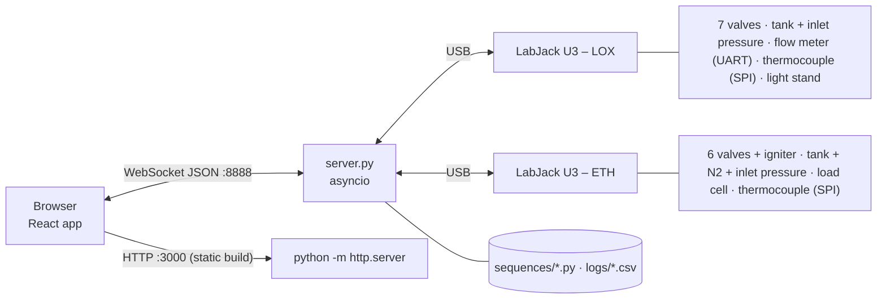

# Test Stand Control Panel – Documentation

Documentation suite for the ANU Rocketry liquid-engine test stand control panel. It describes the code as it stands on branch `documentation` (commit `4357133`). **No application code was modified to produce it.**

Conventions: **[Existing]** = verified in the code · **[Inferred]** = deduced, not stated · **[Theory]** = datasheet/physics background · **[Proposed]** = suggestion, not implemented. References such as `server.py L404` are line numbers in the source file at that commit.

## Project overview

A two-part system for remotely operating and monitoring a LOX/ethanol rocket engine test stand:

- **Backend** (`src/`, Python ≥ 3.10) on a Raspberry Pi: an `asyncio` WebSocket server that drives two LabJack U3 devices (one per propellant stand) to switch valve relays, an igniter channel and a light stand, and to read pressure transmitters, two MAX6675 thermocouple converters, a UART flow meter and a load cell. It broadcasts the full system state about 20 times a second, runs scripted valve sequences, and performs an abort sequence on request or after 15 minutes without clients.
- **Frontend** (`reactfront/`, React 17): a browser app showing a P&ID with valve switches and live sensor values, five live graphs with CSV/SVG export, a sequence runner/editor, and a calibration panel.

## Quick start

```sh
# Backend with simulated hardware
cd src
pip install -r requirements.txt     # only `websockets` is needed for --dev
python server.py --dev              # note the IP it prints

# Frontend
cd reactfront
npm ci
npm start                           # http://localhost:3000 → set "Server IP" to the printed IP
```

Real hardware, Raspberry Pi provisioning and deployment: root [`README.md`](../README.md) and [testing-and-troubleshooting.md](testing-and-troubleshooting.md).

## Architecture at a glance



Full detail: [architecture.md](architecture.md).

## Sensor inventory

| Sensor | Stand | Interface | Unit | Calibrated by the project? | Doc |
|---|---|---|---|---|---|
| Tank pressure | ETH | Analog FIO4 | bar | No (nominal defaults) | [link](sensors/eth-tank-pressure.md) |
| N₂ pressurant pressure | ETH | Analog FIO5 | bar | No | [link](sensors/eth-n2-pressure.md) |
| Motor inlet pressure | ETH | Analog FIO6 | bar | No | [link](sensors/eth-inlet-pressure.md) |
| Load cell | ETH | Analog FIO0 | kg | No (placeholder) | [link](sensors/eth-load-cell.md) |
| Thermocouple (MAX6675) | ETH | SPI | °C | No (identity) | [link](sensors/eth-thermocouple.md) |
| Tank pressure | LOX | Analog FIO4 | bar | No | [link](sensors/lox-tank-pressure.md) |
| Motor inlet pressure | LOX | Analog FIO2 | bar | No | [link](sensors/lox-inlet-pressure.md) |
| N₂ pressurant pressure | LOX | disabled | bar | – | [link](sensors/lox-n2-pressure.md) |
| Cryogenic flow meter | LOX | UART FIO6/7 | L/s | No (firmware) | [link](sensors/lox-cryo-flow.md) |
| Thermocouple (MAX6675) | LOX | SPI | °C | No (identity) | [link](sensors/lox-thermocouple.md) |

Full table, pin map and comparison: [sensors/README.md](sensors/README.md).

## Documentation index

### System level

| Document | Contents |
|---|---|
| [architecture.md](architecture.md) | Purpose, components, start-up, concurrency, safety state machine, dependencies |
| [data-flow.md](data-flow.md) | Telemetry, command, sequence and persistence paths |
| [websocket-protocol.md](websocket-protocol.md) | Every message in both directions, `STATE` schema, sequence file grammar |
| [cross-component-integration.md](cross-component-integration.md) | Measurement lifecycle trace, timestamps, sampling rates, buffering, reliability |
| [testing-and-troubleshooting.md](testing-and-troubleshooting.md) | Running, verifying, failure table, debugging procedures, recommended tests |
| [known-issues.md](known-issues.md) | Bugs, discrepancies, stale code, questions for the hardware team |
| [references.md](references.md) | Datasheets, vendor documentation, confidence notes |

### Components

| Document | Contents |
|---|---|
| [components/backend.md](components/backend.md) | Backend module map and runtime structure |
| [components/frontend.md](components/frontend.md) | Component tree, state ownership, build |
| [components/hardware.md](components/hardware.md) | Pi, LabJacks, valves, relay polarity, light stand |

### Sensors

| Document | Contents |
|---|---|
| [sensors/README.md](sensors/README.md) | Inventory, pin map, comparison, calibration status |
| [sensors/pressure-4-20ma-common.md](sensors/pressure-4-20ma-common.md) | Shared theory, formula, calibration procedure, error analysis for pressure channels |
| [sensors/eth-tank-pressure.md](sensors/eth-tank-pressure.md) · [sensors/eth-n2-pressure.md](sensors/eth-n2-pressure.md) · [sensors/eth-inlet-pressure.md](sensors/eth-inlet-pressure.md) | ETH pressure channels |
| [sensors/lox-tank-pressure.md](sensors/lox-tank-pressure.md) · [sensors/lox-inlet-pressure.md](sensors/lox-inlet-pressure.md) · [sensors/lox-n2-pressure.md](sensors/lox-n2-pressure.md) | LOX pressure channels |
| [sensors/max6675-common.md](sensors/max6675-common.md) | Shared thermocouple chain: MAX6675, SPI driver, decoding, correction |
| [sensors/eth-thermocouple.md](sensors/eth-thermocouple.md) · [sensors/lox-thermocouple.md](sensors/lox-thermocouple.md) | Thermocouple channels |
| [sensors/lox-cryo-flow.md](sensors/lox-cryo-flow.md) | UART flow meter |
| [sensors/eth-load-cell.md](sensors/eth-load-cell.md) | Load cell |

### Source files – backend

| Source | Doc |
|---|---|
| `src/server.py` | [files/src_server.py.md](files/src_server.py.md) |
| `src/labjack.py` | [files/src_labjack.py.md](files/src_labjack.py.md) |
| `src/stands.py` | [files/src_stands.py.md](files/src_stands.py.md) |
| `src/commands.py` | [files/src_commands.py.md](files/src_commands.py.md) |
| `src/datalog.py` | [files/src_datalog.py.md](files/src_datalog.py.md) |
| `src/utils.py` | [files/src_utils.py.md](files/src_utils.py.md) |
| `src/__init__.py` | [files/src___init__.py.md](files/src___init__.py.md) |
| `src/requirements.txt` | [files/src_requirements.txt.md](files/src_requirements.txt.md) |
| `src/sequences/abort.py` | [files/src_sequences_abort.py.md](files/src_sequences_abort.py.md) |
| `src/sequences/operation.py` | [files/src_sequences_operation.py.md](files/src_sequences_operation.py.md) |
| `src/sequences/hfon.py` | [files/src_sequences_hfon.py.md](files/src_sequences_hfon.py.md) |
| `src/sequences/hfoff.py` | [files/src_sequences_hfoff.py.md](files/src_sequences_hfoff.py.md) |
| `startup.sh` | [files/startup.sh.md](files/startup.sh.md) |

### Source files – frontend

| Source | Doc |
|---|---|
| `reactfront/src/index.js` | [files/reactfront_src_index.js.md](files/reactfront_src_index.js.md) |
| `reactfront/src/utils.js` | [files/reactfront_src_utils.js.md](files/reactfront_src_utils.js.md) |
| `reactfront/src/pins.json` | [files/reactfront_src_pins.json.md](files/reactfront_src_pins.json.md) |
| `reactfront/src/index.css` | [files/reactfront_src_index.css.md](files/reactfront_src_index.css.md) |
| `reactfront/src/components/index.js` | [files/reactfront_src_components_index.js.md](files/reactfront_src_components_index.js.md) |
| `reactfront/src/components/graph-utils.js` | [files/reactfront_src_components_graph-utils.js.md](files/reactfront_src_components_graph-utils.js.md) |
| `reactfront/src/components/series.js` | [files/reactfront_src_components_series.js.md](files/reactfront_src_components_series.js.md) |
| `reactfront/src/components/datalogger.js` | [files/reactfront_src_components_datalogger.js.md](files/reactfront_src_components_datalogger.js.md) |
| `reactfront/src/components/panels/control-panel.js` | [files/reactfront_src_components_panels_control-panel.js.md](files/reactfront_src_components_panels_control-panel.js.md) |
| `reactfront/src/components/panels/graph-panel.js` | [files/reactfront_src_components_panels_graph-panel.js.md](files/reactfront_src_components_panels_graph-panel.js.md) |
| `reactfront/src/components/panels/sequence-panel.js` | [files/reactfront_src_components_panels_sequence-panel.js.md](files/reactfront_src_components_panels_sequence-panel.js.md) |
| `reactfront/src/components/panels/calibration-panel.js` | [files/reactfront_src_components_panels_calibration-panel.js.md](files/reactfront_src_components_panels_calibration-panel.js.md) |
| `reactfront/src/components/panels/safety-panel.js` | [files/reactfront_src_components_panels_safety-panel.js.md](files/reactfront_src_components_panels_safety-panel.js.md) |
| `reactfront/package.json` | [files/reactfront_package.json.md](files/reactfront_package.json.md) |
| `reactfront/public/index.html` | [files/reactfront_public_index.html.md](files/reactfront_public_index.html.md) |
| `reactfront/update_frontend.sh` | [files/reactfront_update_frontend.sh.md](files/reactfront_update_frontend.sh.md) |
| SVG/PNG assets, `reactfront/build/` | [files/static-assets.md](files/static-assets.md) |
| `.gitignore`, `.vscode/settings.json`, root `README.md`, `src/logs/` | [files/repo-config.md](files/repo-config.md) |

Not documented individually: `reactfront/package-lock.json` (generated lock file) and the generated bundle under `reactfront/build/`.

## Recommended reading order for a new developer

1. This page, then [architecture.md](architecture.md) – the whole picture in ten minutes.
2. Run the system in dev mode (Quick start) and click through all three views.
3. [websocket-protocol.md](websocket-protocol.md) – the contract between the halves.
4. Backend: [files/src_stands.py.md](files/src_stands.py.md) → [files/src_commands.py.md](files/src_commands.py.md) → [files/src_labjack.py.md](files/src_labjack.py.md) → [files/src_server.py.md](files/src_server.py.md).
5. Frontend: [components/frontend.md](components/frontend.md) → [files/reactfront_src_index.js.md](files/reactfront_src_index.js.md) → [files/reactfront_src_utils.js.md](files/reactfront_src_utils.js.md) → [files/reactfront_src_pins.json.md](files/reactfront_src_pins.json.md) → the panels.
6. [data-flow.md](data-flow.md) and [cross-component-integration.md](cross-component-integration.md) – follow one measurement end to end.
7. [sensors/README.md](sensors/README.md), then the two common sensor documents, then individual sensors as needed.
8. [known-issues.md](known-issues.md) – **read before operating hardware or changing pin assignments.**
9. [testing-and-troubleshooting.md](testing-and-troubleshooting.md) when something misbehaves.

## Most important things to know

1. Pin numbers are duplicated by hand in `src/stands.py`, `reactfront/src/pins.json`, `reactfront/src/utils.js` and `sequence-panel.js`; they are currently out of sync for LOX N₂.
2. Unit conversion and calibration happen **in the browser**, per browser; server logs contain volts.
3. No sensor has a recorded project calibration; defaults are nominal or placeholders.
4. The MAX6675 cannot read below 0 °C, so the LOX thermocouple cannot measure cryogenic temperatures.
5. ABORT only works while armed; a LabJack read error stops the server; outputs are not driven to a safe state on exit.
