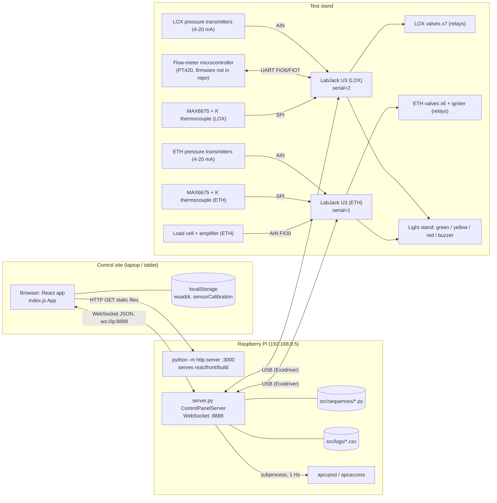
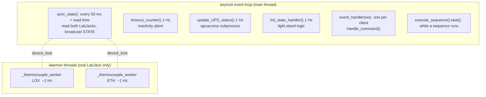
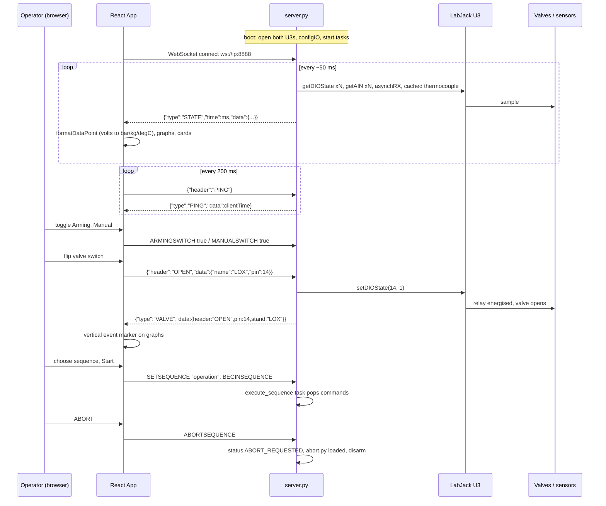
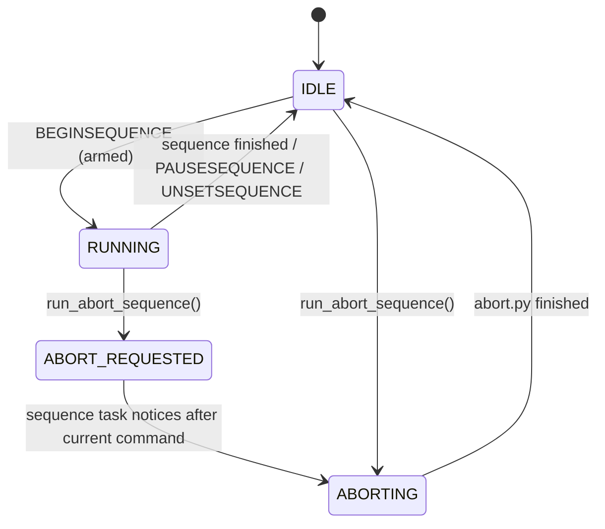

# System Architecture and End-to-End Workflow

> Labels used throughout this documentation suite
> **[Existing]** – behaviour verified by reading the code. **[Inferred]** – deduced from code/comments, not directly stated. **[Theory]** – background from datasheets/physics. **[Proposed]** – a suggested improvement that is *not* implemented.

## 1. Purpose

The project is the remote control and data-acquisition panel for the ANU Rocketry liquid bi-propellant engine test stand. It solves three problems:

1. **Remote actuation** – open/close the solenoid valves (and the igniter channel) of two propellant feed systems, **ETH** (ethanol fuel) and **LOX** (liquid oxygen oxidiser), from a safe distance, either manually or through timed, scripted sequences.
2. **Live telemetry** – read pressure, flow, temperature and thrust (load cell) sensors and show them numerically on a P&ID-style diagram and as scrolling graphs.
3. **Safety behaviour** – software arming interlocks, an abort sequence (manual, or automatic after 15 minutes with no connected client), a physical light stand reflecting system state, and UPS power-status reporting.

## 2. Components

| Layer | Technology | Location | Runs on |
|---|---|---|---|
| Frontend | React 17 single-page app (Create React App, Material-UI 4, hand-written SVG graphs) | [`reactfront/`](../reactfront) | Any browser; static build served by the Pi on port 3000 |
| Backend | Python ≥ 3.10 `asyncio` + `websockets` server | [`src/`](../src) | Raspberry Pi (or a laptop in `--dev` mode), port 8888 |
| DAQ / actuation hardware | Two LabJack U3 USB devices, one per stand, driven by `LabJackPython==2.0.4` over the Exodriver | [`src/labjack.py`](../src/labjack.py), [`src/stands.py`](../src/stands.py) | USB-attached to the Pi |
| Sequences | Line-per-command text files with a `.py` extension | [`src/sequences/`](../src/sequences) | Read and `exec`'d by the backend |
| External service | `apcupsd` daemon (`apcaccess status`) for UPS line/battery status | system package on the Pi | Pi |
| Network | Point-to-point Wi-Fi (Ubiquiti) + router; Pi static IP `192.168.0.5` | described in the root [`README.md`](../README.md) | – |

There is **no database, no HTTP API and no cloud service**. All state lives in the memory of the single Python process; the only persistent outputs are optional CSV logs (`src/logs/`), sequence files, and per-browser calibration constants in `localStorage`.

## 3. Architecture diagram

## 4. Process and entry points

| Entry point | What starts it | What it does |
|---|---|---|
| [`startup.sh`](../startup.sh) | `/etc/rc.local` on the Pi at boot | Sleeps 20 s, starts `python3.10 server.py` (output → `logs.txt`) and `python3.10 -m http.server 3000` in `reactfront/build` |
| `src/server.py` `__main__` (lines 645-649) | `python server.py [--dev]` | Builds `ControlPanelServer`, runs `asyncio.run(server.start_server())` |
| `reactfront/src/index.js` (lines 233-238) | Browser loads the bundle | `ReactDOM.render(<App/>)`; `App` constructor opens the WebSocket |
| `npm start` / `npm run build` | Developer | CRA dev server on :3000 / produce `reactfront/build` |

## 5. Backend initialisation

Order of events when `python server.py` runs ([`src/server.py`](../src/server.py)):

1. Module import: `devMode = '--dev' in sys.argv` (line 18); constants `STATE_BROADCAST_FREQUENCY = 20`, `ABORT_SEQUENCE_TIMEOUT = 900`, `LOG_PATH = src/logs` (lines 20-23).
2. `utils.get_local_ip()` opens a UDP socket "towards" 8.8.8.8 to discover the outbound interface address (no packet is sent). **This raises `OSError` if the machine has no route** (see [testing-and-troubleshooting.md](testing-and-troubleshooting.md)).
3. `ControlPanelServer.__init__` (lines 102-128): creates `SystemState`, then `get_class(devMode)(LOX, …)` and `…(ETH, …)`. For real hardware each `LabJack.__init__`:
   - asserts `LabJackPython.__version__ == '2.0.4'`;
   - opens `u3.U3(firstFound=False, serial=<SerialNumber>)`;
   - builds the analog bitmask from `Sensors` and calls `configIO(FIOAnalog=mask, EIOAnalog=0)`;
   - if the stand has `CryoFlowUART`: `configIO(EnableUART=True, TimerCounterPinOffset=tx)` then `asynchConfig(...)`;
   - if the stand has `Thermocouple`: starts the daemon thread `_thermocouple_worker`.
   Any exception prints the traceback plus a hint and calls `exit(0)`.
4. `refresh_available_sequences()` scans `src/sequences/*.py`.
5. `start_server()` (lines 585-591) schedules four forever-running coroutines and then serves WebSockets until the process is killed.

## 6. Concurrency model

Key facts **[Existing]**:

- All LabJack calls made from the event loop are **synchronous, blocking USB calls**; nothing else on the loop runs while they execute. The only off-loop hardware work is the thermocouple worker thread.
- `threading.Lock` `_device_lock` (one per LabJack object) serialises every `self.device.*` call between the worker thread and the event loop; `_tc_lock` guards the cached temperature.
- Shared Python state (`self.state`) is mutated only on the event loop, so no locks are needed there. The exception is `log_debug`, which is only called from the event-loop thread in the current code (`get_cryo_flow_lps`, `send_cryo_command`, `__init__`).
- There is no graceful shutdown: no signal handlers, no `finally` that closes valves or the LabJack handles. Stopping the process leaves every relay in its last state (see [known-issues.md](known-issues.md)).

## 7. End-to-end workflow

Detailed descriptions of each arrow are in [data-flow.md](data-flow.md) and [websocket-protocol.md](websocket-protocol.md).

## 8. The safety state machine

`SystemState.status` takes the values of `SequenceStatus` (`server.py` lines 37-46):

Interlocks **[Existing]** (all enforced server-side in `handle_command`, lines 404-506):

| Action | Requirement |
|---|---|
| Change arming / manual switch | No sequence running (`sequence_running()` false) |
| Manual `OPEN` / `CLOSE` | `arming_switch` **and** `manual_switch` |
| `SETSEQUENCE`, `BEGINSEQUENCE`, `SAVESEQUENCE`, `DELETESEQUENCE` | `arming_switch` |
| `ABORTSEQUENCE` | `arming_switch` (an un-armed system ignores the abort request) |
| Sequence `Open`/`Close` actually driving hardware | `arming_switch` **or** `status == ABORTING` (`sequence_command_allowed`, line 625) |
| `PAUSESEQUENCE`, `UNSETSEQUENCE` | Not while `ABORTING` |
| `DATALOG`, `GETSEQUENCE`, `CRYOCOMMAND`, `PING` | none |

Starting a sequence forces `manual_switch = False` (line 601). Running the abort sequence forces `arming_switch = False` and `manual_switch = False` (lines 243-244).

Automatic abort: `timeout_counter` fires `run_abort_sequence()` once when no client has been connected for more than 900 s since the last disconnect (or since server start). The flag `inactive_abort_fired` is re-armed by any incoming client message.

## 9. Dependencies and why they exist

### Backend ([`src/requirements.txt`](../src/requirements.txt))

| Package | Used for | Notes |
|---|---|---|
| `websockets` (unpinned) | WebSocket server (`websockets.serve`), `ConnectionClosedError` | Handler is declared `event_handler(self, ws, path="None")` so it works with both the legacy (two-argument) and new (one-argument) handler signatures |
| `asyncio` | Listed, but `asyncio` is in the standard library for Python ≥ 3.4 | **[Inferred]** the PyPI package of this name is an obsolete backport and is unnecessary; see [known-issues.md](known-issues.md) |
| `LabJackPython==2.0.4` | `u3.U3` device class: `configIO`, `getAIN`, `getDIOState`, `setDIOState`, `spi`, `asynchConfig`, `asynchRX`, `asynchTX` | Version asserted at runtime in `labjack.py` line 127; only imported in non-dev mode |
| Exodriver (`liblabjackusb`, system library) | USB transport under LabJackPython | Installed per root README |
| Python ≥ 3.10 | `match` statements, `X \| None` annotations | – |
| stdlib | `dataclasses`, `json`, `csv`, `pathlib`, `threading`, `socket`, `traceback` | – |

### Frontend ([`reactfront/package.json`](../reactfront/package.json))

| Package | Used for |
|---|---|
| `react`, `react-dom` 17 | UI |
| `react-scripts` 5 | Build tooling (webpack, babel, eslint) |
| `@material-ui/core` 4 | `Switch`, `Paper`, `Snackbar`, `Button`, `Table*`, `withStyles` |
| `scroll-lock` | Disable page scrolling while the mouse wheel zooms a graph (`graph-panel.js`) |
| `cross-env` (dev) | Sets `NODE_OPTIONS=--openssl-legacy-provider` for the build scripts |
| `@material-ui/lab`, `moment`, `recharts`, `node-pre-gyp` | **Declared but not imported by any file in `reactfront/src`** |

## 10. Shutdown

- **Backend**: none implemented. `Ctrl+C` / `pkill python3.10` terminates `asyncio.run`; daemon threads die with the process; CSV log files are flushed after every row so no data is lost, but the file is never explicitly closed.
- **Frontend**: `componentWillUnmount` clears the ping interval. Closing the tab closes the socket; the server removes the client and records `time_of_last_disconnect`, which starts the 15-minute inactivity abort countdown.
