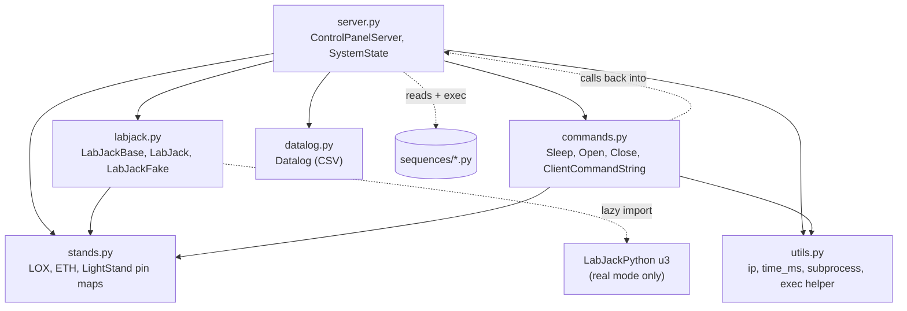

# Backend Overview (`src/`)

A single Python process: an `asyncio` WebSocket server that owns the two LabJacks, the system state, the sequence engine and the optional CSV log.

## Module map

| File | Lines | Responsibility | Doc |
|---|---|---|---|
| `server.py` | 649 | State, WebSocket handling, periodic tasks, sequence execution, sequence file CRUD | [files/src_server.py.md](../files/src_server.py.md) |
| `labjack.py` | 422 | Hardware abstraction (real + fake), sensor drivers | [files/src_labjack.py.md](../files/src_labjack.py.md) |
| `stands.py` | 95 | Pin definitions | [files/src_stands.py.md](../files/src_stands.py.md) |
| `commands.py` | 93 | Sequence/manual command objects, protocol header names | [files/src_commands.py.md](../files/src_commands.py.md) |
| `datalog.py` | 25 | CSV writer | [files/src_datalog.py.md](../files/src_datalog.py.md) |
| `utils.py` | 47 | Helpers | [files/src_utils.py.md](../files/src_utils.py.md) |
| `__init__.py` | 0 | Empty package marker | [files/src___init__.py.md](../files/src___init__.py.md) |
| `requirements.txt` | 3 | Dependencies | [files/src_requirements.txt.md](../files/src_requirements.txt.md) |
| `sequences/*.py` | 14–20 | Command scripts | [abort](../files/src_sequences_abort.py.md), [operation](../files/src_sequences_operation.py.md), [hfon](../files/src_sequences_hfon.py.md), [hfoff](../files/src_sequences_hfoff.py.md) |

Imports are flat (`from stands import LOX`), so the server **must be started with `src/` as the working directory** (as `startup.sh` does); `__init__.py` is not what makes the imports work.

## Runtime structure

- One `ControlPanelServer` instance holding `self.state: SystemState`, `self.labjacks: {'LOX': …, 'ETH': …}`, `self.clients: set`, `self.datalog`.
- Four background coroutines started in `start_server`: `sync_state` (20 Hz acquisition + broadcast), `timeout_counter` (inactivity abort), `update_UPS_status`, `init_state_handler` (light stand).
- One `event_handler` coroutine per connected browser.
- A transient task per running sequence (`execute_sequence`).
- One daemon thread per real LabJack that has a thermocouple.

See [architecture.md §5–§8](../architecture.md#5-backend-initialisation) for start-up, concurrency and the state machine.

## Hardware abstraction

`LabJackBase` defines the interface the rest of the backend uses:

| Method | Purpose |
|---|---|
| `open_valve(pin)`, `close_valve(pin)`, `set_valve_state(pin, open)` | Actuation in "mechanical" terms |
| `get_valve_state(pin)` | Mechanical open/closed read-back |
| `get_voltage(pin)` | Analog volts |
| `get_thermocouple_temp()` | Cached °C or `None` |
| `get_cryo_flow_lps()` | Latest L/s or `None` |
| `send_cryo_command(char)` | One byte to the flow MCU |
| `_set_digital_state(pin, state)`, `_get_digital_state(pin)` | Raw line access (light stand) |
| `get_state()` | Snapshot dict for the `STATE` message |

`get_class(dev)` selects `LabJackFake` (`--dev`) or `LabJack`. The fake needs no LabJack libraries, which is what allows laptop development.

## State ownership

`SystemState` (a dataclass) is the single source of truth and is serialised whole into every `STATE` message; clients hold no authoritative state. Fields and their meaning: [websocket-protocol.md](../websocket-protocol.md#statedata-schema).

## Sequence engine in brief

- A sequence is a `list[ServerCommand]` produced by `load_sequence(name)`.
- `execute_sequence` pops commands one at a time and awaits `command.act(server)`.
- `Sleep.act` polls every 5 ms so it can be interrupted by pause/abort.
- `Open/Close.act` call back into `server.labjacks[...]` and broadcast a `VALVE` event.

## Persistence

| What | Where | Written by |
|---|---|---|
| Data log | `src/logs/<YYYYmmdd-HHMMSS>.csv` (git-ignored) | `Datalog`, when logging is toggled on |
| Sequences | `src/sequences/<name>.py` | `save_sequence`, `delete_sequence` |
| Process stdout/stderr | `/home/pi/control-panel/logs.txt` (overwritten each boot) | `startup.sh` redirect |

## Error-handling philosophy (as implemented)

- Per-message `try/except` in `event_handler`: client mistakes become warnings.
- Hardware read failures are fatal (`sys.exit()`); hardware write failures propagate.
- Broad bare `except:` in `broadcast`, `__init__` and sequence loading.

Details and consequences: [cross-component-integration.md §8](../cross-component-integration.md#8-reliability-characteristics), [known-issues.md](../known-issues.md).
