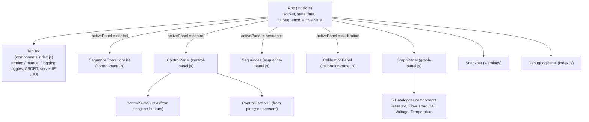

# Frontend Overview (`reactfront/`)

A Create React App single-page application. No router, no Redux, no REST calls: one root class component owns a WebSocket and passes server state down as props.

## Component tree

The left side shows one of three views (buttons "Control Panel", "Config Panel" = sequence editor, "Sensor Calibration"); the graph panel, top bar and debug log are always visible.

## File map

| File | Role | Doc |
|---|---|---|
| `src/index.js` | Entry point, `App`, WebSocket client, `DebugLogPanel` | [files/reactfront_src_index.js.md](../files/reactfront_src_index.js.md) |
| `src/utils.js` | Conversion formulas, calibration store, `formatDataPoint` | [files/reactfront_src_utils.js.md](../files/reactfront_src_utils.js.md) |
| `src/pins.json` | Valve switch and sensor card definitions/positions | [files/reactfront_src_pins.json.md](../files/reactfront_src_pins.json.md) |
| `src/index.css` | All styling; P&ID background image | [files/reactfront_src_index.css.md](../files/reactfront_src_index.css.md) |
| `src/components/index.js` | `TopBar`, `Panel`, `ToggleSwitch`, switch styles | [files/reactfront_src_components_index.js.md](../files/reactfront_src_components_index.js.md) |
| `src/components/panels/control-panel.js` | P&ID view: switches, sensor cards, execution list, igniter confirm | [files/reactfront_src_components_panels_control-panel.js.md](../files/reactfront_src_components_panels_control-panel.js.md) |
| `src/components/panels/graph-panel.js` | Graph engine + 5 graph instances + CSV/SVG export, `pinFromID` | [files/reactfront_src_components_panels_graph-panel.js.md](../files/reactfront_src_components_panels_graph-panel.js.md) |
| `src/components/panels/sequence-panel.js` | Sequence chooser, runner, editor | [files/reactfront_src_components_panels_sequence-panel.js.md](../files/reactfront_src_components_panels_sequence-panel.js.md) |
| `src/components/panels/calibration-panel.js` | Calibration forms, cryo test-mode button | [files/reactfront_src_components_panels_calibration-panel.js.md](../files/reactfront_src_components_panels_calibration-panel.js.md) |
| `src/components/panels/safety-panel.js` | `SafetyCard` (unused) | [files/reactfront_src_components_panels_safety-panel.js.md](../files/reactfront_src_components_panels_safety-panel.js.md) |
| `src/components/series.js` | Typed-array time-series store with min/max decimation | [files/reactfront_src_components_series.js.md](../files/reactfront_src_components_series.js.md) |
| `src/components/graph-utils.js` | Tick generation, binary search, interval maths | [files/reactfront_src_components_graph-utils.js.md](../files/reactfront_src_components_graph-utils.js.md) |
| `src/components/datalogger.js` | Abandoned prototype (not imported) | [files/reactfront_src_components_datalogger.js.md](../files/reactfront_src_components_datalogger.js.md) |
| `public/index.html` | HTML shell | [files/reactfront_public_index.html.md](../files/reactfront_public_index.html.md) |
| `package.json` | Dependencies and scripts | [files/reactfront_package.json.md](../files/reactfront_package.json.md) |
| `update_frontend.sh` | Build + `scp` deploy helper | [files/reactfront_update_frontend.sh.md](../files/reactfront_update_frontend.sh.md) |
| `src/labjack.svg`, `labjack-1.svg`, `public/logo.png`, … | Static assets | [files/static-assets.md](../files/static-assets.md) |

## State and data flow

| State | Owner | Notes |
|---|---|---|
| `state.data` | `App` | Latest `STATE.data` from the server (replaced ~20×/s → whole tree re-renders at that rate) |
| `socketStatus`, `wsAddress`, `ping` | `App` | `wsAddress` persisted in `localStorage["wsaddr"]` |
| `fullSequence`, `fullSequenceName` | `App` | Snapshot of a sequence at load time, so executed commands remain visible |
| `events` | `App` | List of valve events (also pushed to graphs) |
| Graph data | module-level closures in `graph-panel.js` (outside React) | Fed by DOM `CustomEvent`s `datalogger-new-data` / `datalogger-new-event` |
| Calibration (`sensorData`) | module-level variable in `utils.js` | Persisted in `localStorage["sensorCalibration"]`; page reload after every change |
| Sensor card averages | `ControlPanel` hooks | Lost when the Control Panel view unmounts |
| Editor state | `Sequences` hooks | – |

**Why DOM events for graphs?** `Datalogger({...})` is a factory called once at module load. It creates a private `SeriesCollection`, registers document-level listeners, and returns a component. `index.js` calls `newData(point)` for each state message; each datalogger picks out the keys it cares about. This keeps 20 Hz data out of React state; the component is force-updated via `requestAnimationFrame`.

## Rendering the P&ID

`.control-panel` has `labjack.svg` as its CSS background. Switches and cards are absolutely positioned from `pins.json` `position` values multiplied by 26 px (`normalisePosition`). To move a widget, edit its `x`/`y` in `pins.json`; to add a valve, add a `buttons` entry (and the backend/abort changes listed in [files/reactfront_src_pins.json.md](../files/reactfront_src_pins.json.md)).

## Build and deployment

- `npm start` – dev server with hot reload on `http://localhost:3000`.
- `npm run build` – static bundle in `reactfront/build/`, **which is committed to git** and served on the Pi by `python -m http.server 3000`.
- Both scripts set `NODE_OPTIONS=--openssl-legacy-provider` via `cross-env`.
- `update_frontend.sh` rebuilds and `scp`s the build to the Pi.

There are no frontend tests and no lint script beyond CRA's built-in ESLint during build.
