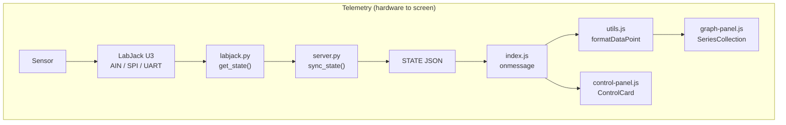
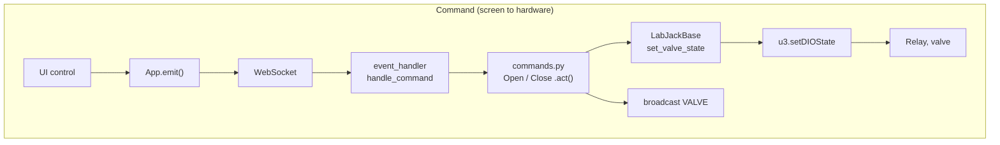
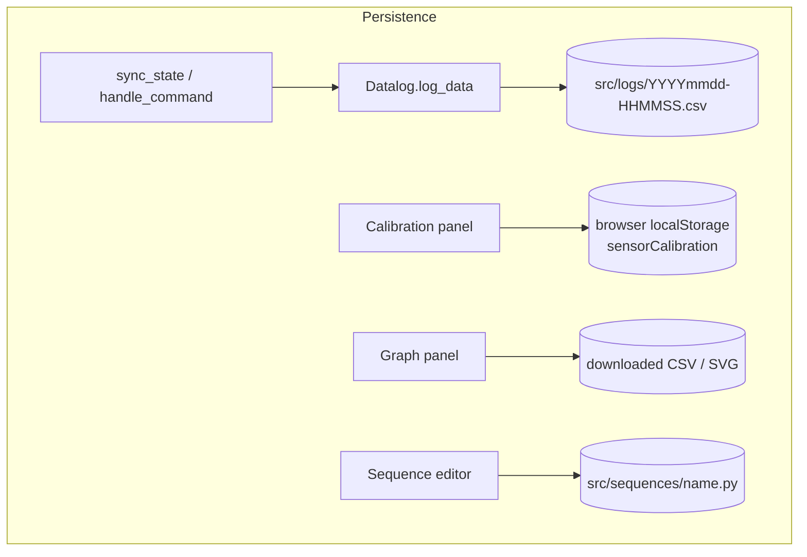
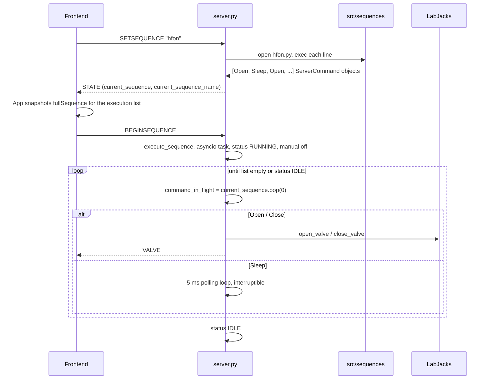

# Data Flow and Component Interactions

This document follows data through the system. For message formats see [websocket-protocol.md](websocket-protocol.md); for the integrated, timing-level view see [cross-component-integration.md](cross-component-integration.md).

## 1. The three data paths

## 2. Telemetry path, stage by stage

| # | Stage | Code | Data form at exit |
|---|---|---|---|
| 1 | Physical transduction | hardware | 4–20 mA loop / mV thermocouple / pulse train / bridge voltage |
| 2 | Signal conditioning | hardware (120 Ω shunt per code comments, MAX6675, flow MCU, load-cell amplifier) | 0.48–2.4 V / 16-bit SPI word / ASCII CSV line / DC volts |
| 3 | Acquisition | `LabJack.get_voltage` (L201), `_read_thermocouple_once` (L211), `get_cryo_flow_lps` (L291) in [`labjack.py`](../src/labjack.py) | Python `float` volts / °C / L/s, or `None` |
| 4 | Aggregation | `LabJackBase.get_state` (L71-94) | `{"digital":{pin:bool}, "analog":{pin:volts}, "light_stand":{…}, "temperature":…, "cryo_flow_lps":…}` |
| 5 | State assembly | `sync_state` (`server.py` L152-162) | `state.labjacks[stand] = …`, `state.time = ms` |
| 6 | Serialisation + broadcast | `SystemState.as_dict` (L90-97), `broadcast`/`emit` (L628-643) | JSON text frame `STATE` |
| 7 | Reception | `socket.onmessage` (`index.js` L112-176) | JS object; `data.data.time` converted ms → s |
| 8 | Unit conversion + calibration | `formatDataPoint` (`utils.js` L218-255) | flat object `{time, 'LOX Tank': bar, 'LOX Tank V': volts, …}` |
| 9 | Flow smoothing (LOX Flow only) | `index.js` L129-139 | 10-sample rolling mean replaces `'LOX Flow'` |
| 10 | Graph storage | `newData` → `datalogger-new-data` DOM event → `Series.push` (`series.js` L217) | packed `Float64Array` + decimation pyramid |
| 11 | Graph rendering | `Datalogger` component (`graph-panel.js` L83-495) | SVG polylines |
| 12 | Numeric cards | `ControlCard` (`control-panel.js` L144-244) – converts independently from `state.data`, 20-sample block average | text e.g. `30.02 Bar (1.056V)` |

Two things worth emphasising:

- **The backend never converts to engineering units** (except the flow MCU's L/s and the MAX6675's °C, which arrive pre-converted from the hardware). Volts → bar/kg and the temperature correction happen in the browser, using calibration constants stored in that browser's `localStorage`. Two operators on different laptops can therefore see different numbers for the same raw voltage.
- **Conversion is done twice in the frontend**, by two independent call sites that both use `sensorData`: `formatDataPoint` (graphs) and `ControlCard` (cards).

## 3. Command path, stage by stage

Example: operator flips the "LOX Main" switch on.

1. `ControlSwitch.setValue` (`control-panel.js` L113-115) reads the current `digital[14]`; it is `false`, so it calls `emit('OPEN', {name:'LOX', pin:14})`.
2. `App.emit` (`index.js` L181) sends `{"header":"OPEN","data":{"name":"LOX","pin":14},"time":…}` if the socket is open (otherwise the command is dropped silently).
3. `event_handler` (`server.py` L214) receives it, resets `inactive_abort_fired`, logs a `REQUEST` row if logging, parses JSON, calls `handle_command`.
4. `handle_command` `OPEN` branch (L421-423) checks `arming_switch and manual_switch`, constructs `Open('LOX', 14)` and awaits `.act(self)`.
5. `Open.act` (`commands.py` L52-58) checks `server.sequence_command_allowed()` and calls `server.labjacks['LOX'].open_valve(14)` → `set_valve_state(14, True)` → `LabJack._set_valve_state` → (invert if vent) → `_set_digital_state` → `device.setDIOState(14, state=1)` under `_device_lock`.
6. `Open.act` schedules `broadcast('VALVE', {...})` to every client.
7. Within ≤ 50 ms the next `sync_state` tick reads `getDIOState(14)` back and the `STATE` broadcast shows `digital["14"]: true`; the switch in every connected browser moves. **The UI is not optimistic** – the switch position is always the server's read-back.
8. Each browser's `VALVE` handler (`index.js` L163-172) adds a labelled vertical marker ("Opened LOX main") to all graphs.

The igniter (`ETH` pin 10) takes the same path but `ControlPanel` wraps `emit` so that `OPEN` first shows a confirmation modal (`control-panel.js` L310-316, L360-418).

## 4. Sequence path

- **Pause**: `PAUSESEQUENCE` sets `status = IDLE`; `Sleep.act` sees `should_interrupt_sleep()`, stores the remaining ms in `self.ms`, returns `False`, so `command_in_flight` is kept. A later `BEGINSEQUENCE` re-inserts it at the head of the list (`execute_sequence` L594-597).
- **Abort while running**: `run_abort_sequence` sets `status = ABORT_REQUESTED` and replaces `current_sequence` with the parsed `abort.py`. The in-flight sleep breaks, the task flips the status to `ABORTING` (L610-611) and keeps popping – now from the abort list.
- **Abort while idle**: loads `abort.py` and calls `execute_sequence(initial_state=ABORTING)`.

## 5. Out-of-band flows

| Flow | Producer | Consumer | Mechanism |
|---|---|---|---|
| Warnings | `push_warning` (`server.py` L168) | `App.pushWarning` → Material-UI `Snackbar` | `state.latest_warning` inside every `STATE` |
| Debug log | `log_debug` (L171) – called by `labjack.py` `[CRYO]` diagnostics | `DebugLogPanel` (`index.js` L16-41) | last 50 lines inside every `STATE` |
| UPS status | `update_UPS_status` (L206), `apcaccess status` subprocess | `TopBar` | `state.UPS_status` |
| Light stand | `init_state_handler` (L508-583) | physical lamps via `_set_digital_state` | 1 Hz rule table; also visible as `labjacks[stand].light_stand` |
| Latency | `PING` every 200 ms | `App.state.ping` (stored but not displayed anywhere) | echo of client time |
| Cryo flow commands | Calibration panel "Test Mode" button | flow MCU | `CRYOCOMMAND` → `asynchTX([ord('t')])` |

## 6. Formats at a glance

| Boundary | Format |
|---|---|
| Sensor → U3 | Analog volts (single-ended), SPI mode "B" 16-bit, UART 8N1 at a requested 114 286 baud |
| U3 → Pi | LabJack low-level USB packets via Exodriver (opaque; handled by LabJackPython) |
| Pi → browser | WebSocket text frames, JSON |
| Server log | CSV `TIME,CODE,DATA`; `DATA` is the Python `str()` of the object (a Python literal, **not JSON**) |
| Browser CSV export | `Timestamp (s),<series…>,Valve Events`, 3 decimal places, time relative to the first sample |
| Calibration | `localStorage["sensorCalibration"]` = JSON of the whole `sensorData` object |
| Sequences | One Python call expression per line |
